<div align="center">

> V24 release · [live portfolio](https://manimarami.com/) · [source and verification](RELEASE.md)

<a href="https://manimarami.com/">
  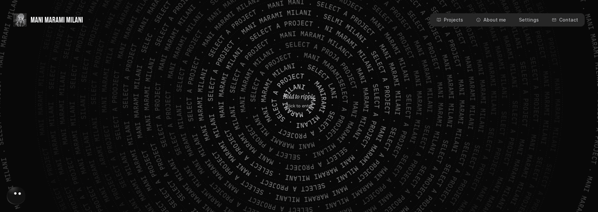
</a>

# Mani Marami Milani · Portfolio

**Eight real projects. One continuous journey.**<br>
An interactive portfolio with a living typographic opening, a scrolling project reel and a galaxy-to-ocean descent.

[](https://react.dev/)
[](https://www.typescriptlang.org/)
[](https://threejs.org/)
[](https://vite.dev/)

[**Open the portfolio ↗**](https://manimarami.com/) · [Showcase](#the-experience) · [Controls](#controls) · [Run locally](#run-locally) · [Architecture](#architecture) · [Credits](#credits)

<br>

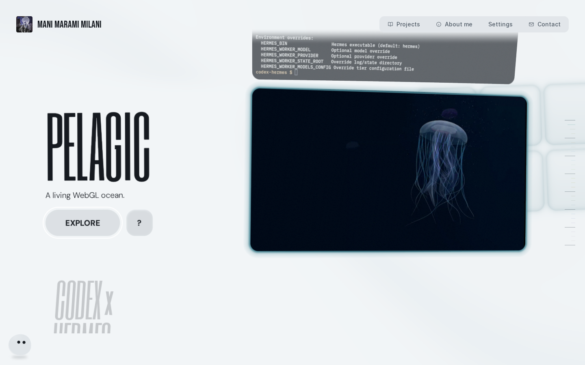

*Real project imagery, original interaction code, and a live WebGL world.*

</div>

## The experience

The opening is an infinite field of type. Scroll to move through its rings, click or hold to send independent ripples through the field, then enter a reel of eight actual repositories. Pelagic launches the protected galaxy, Earth, cloud and ocean journey; the other projects open their real destinations.

| Opening | Project reel |
|:---:|:---:|
| 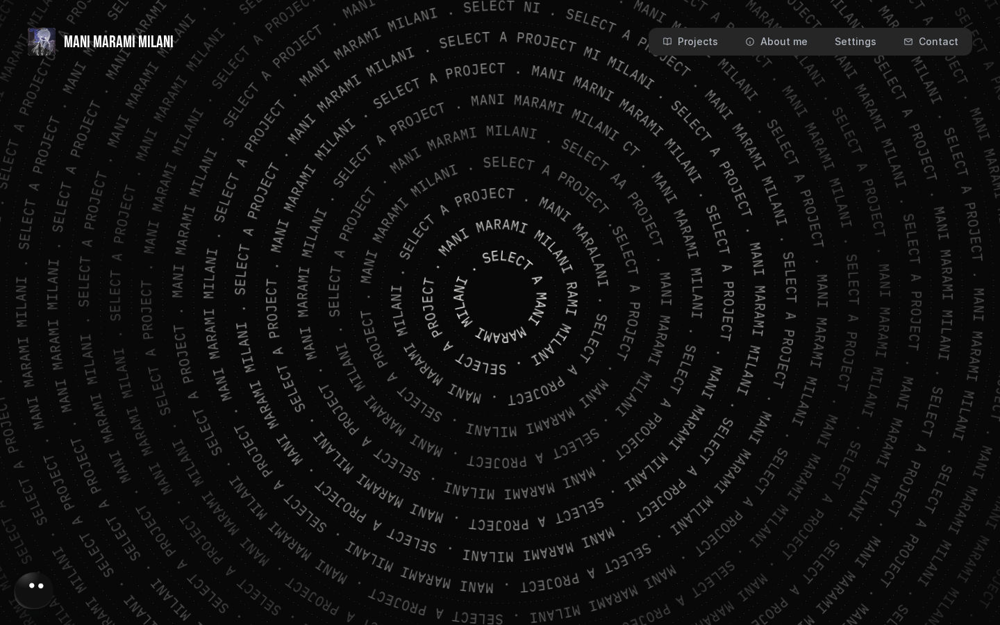 | 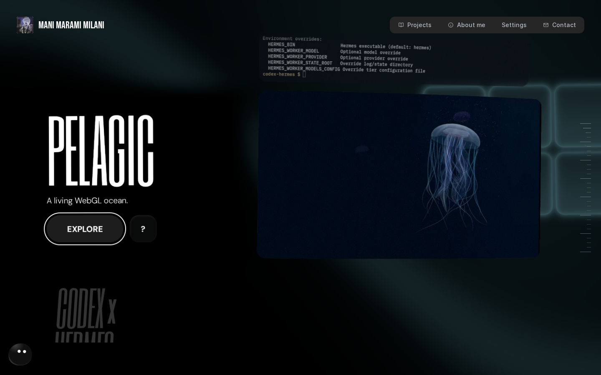 |
| Infinite type, pointer ripples and held zoom | Counter-traveling native text and media, intentional previews and exact project position |

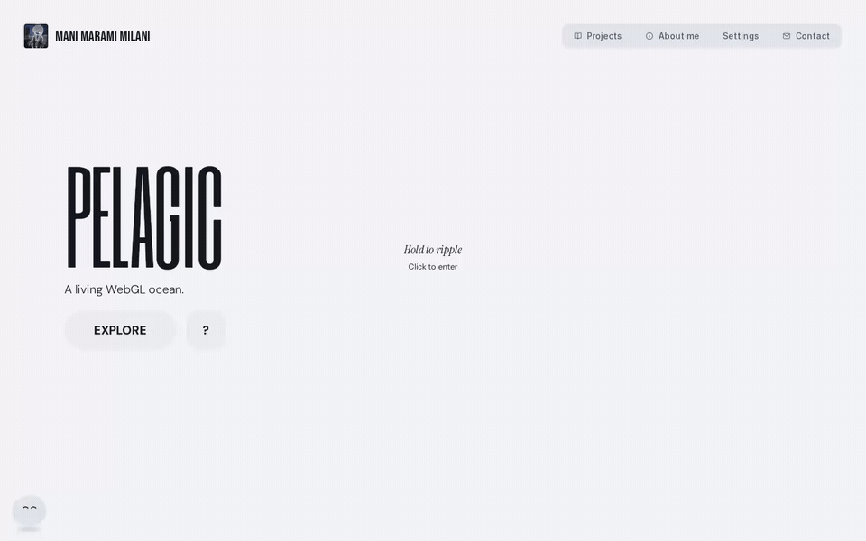

The motion preview is a silent, resized copy of a real browser recording at its original pace. It does not replace the interactive site.

### From galaxy to Pelagic

<a href="https://github.com/Denoax/pelagic-jellyfish-webgl">
  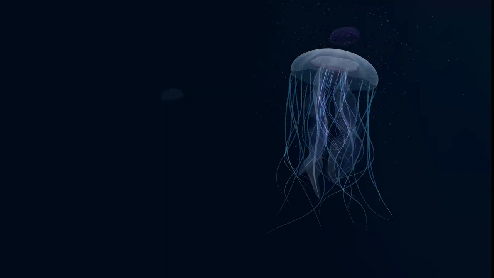
</a>

Pelagic retains its original anatomy, underwater lighting and motion. Travel has authored camera staging and supports forward and reverse movement. The final water crossing opens the canonical [Pelagic project](https://denoax.github.io/pelagic-jellyfish-webgl/); browser Back returns to the portfolio.

### Light and dark

| Light | Dark |
|:---:|:---:|
| 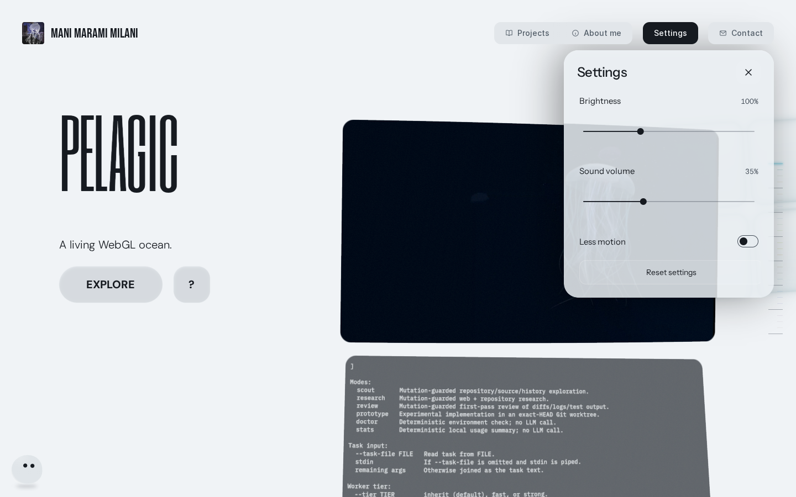 | 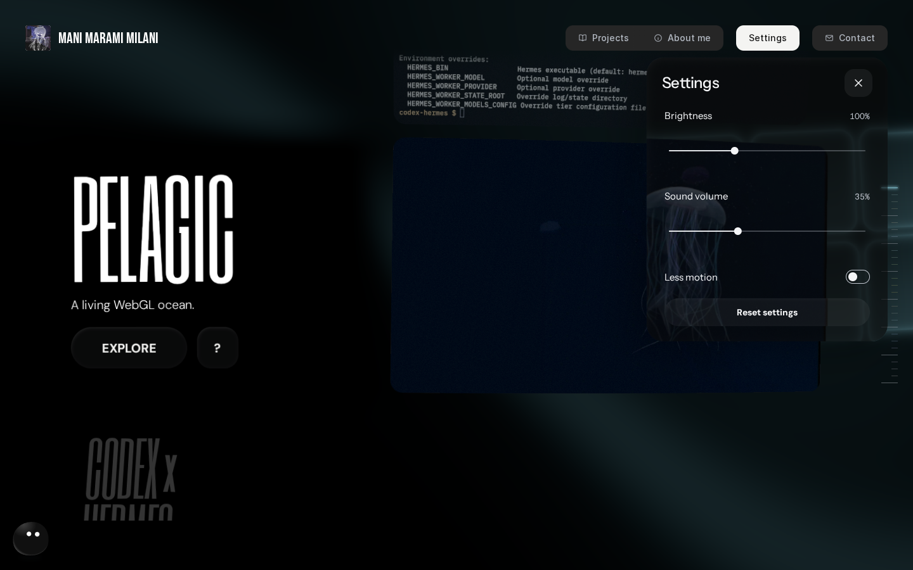 |

The theme buddy changes the appearance. Brightness, sound volume and Less motion control actual rendering and playback behavior. Elastic sliders keep their numeric values bounded while allowing the thumb to travel beyond the pane. The compact shared-glass Reset restores those three visible preferences without changing the selected theme or tour speed.

<details>
<summary><strong>Portrait gallery</strong></summary>

<br>

<p align="center">
  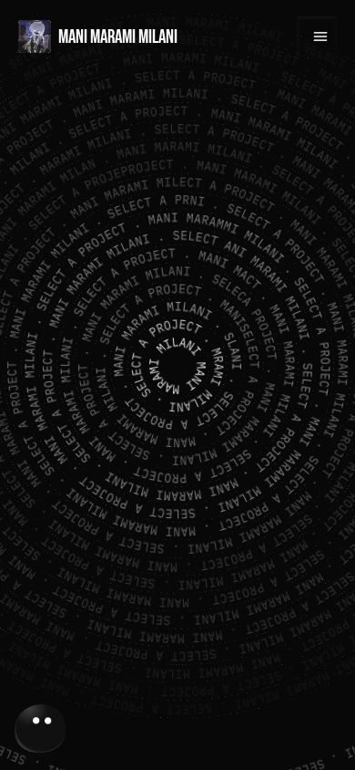
  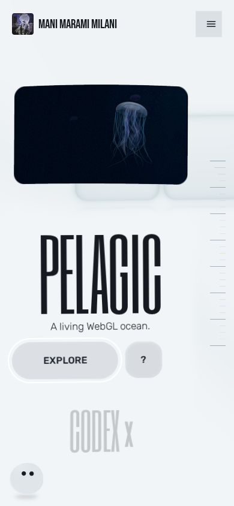
  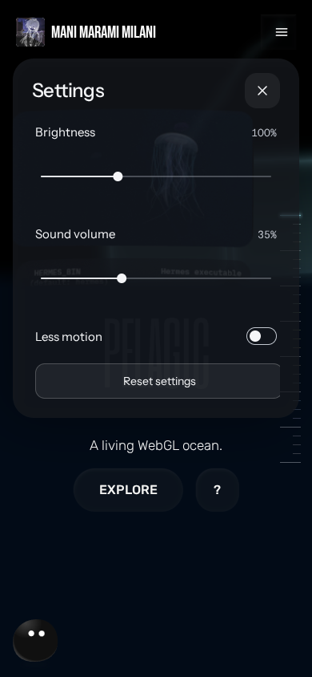
</p>

Mobile has its own composition, safe edge spacing, scrollable pane bodies and persistent Close controls. Keyboard access, reduced motion and a static graphics fallback preserve access to the real content.

</details>

## Built in

| Area | Behavior |
|:---|:---|
| Opening | Continuous Ringwriter, independent pointer ripples and held zoom |
| Projects | Eight real entries, manual scrolling, hover media and direct selection |
| Position rail | Displayed-position bulge on21 fine ticks, stronger pointer hover and8 settled markers |
| Panes | Real-content4px flying panes, native controls, immediate dismissal and shared Close |
| Preferences | Light/dark, bounded brightness, sound volume, Less motion and a scoped Reset |
| Pelagic | Original procedural jellyfish, reversible descent, tour speed and canonical handoff |
| Resilience | Readiness-gated route fades, cancellation, graphics retry and static content |

## Controls

| Where | Input | Result |
|:---|:---|:---|
| Opening | Scroll; click or hold the field | Move through the rings; emit independent ripples |
| Opening | Enter while the opening is focused; Projects in navigation | Enter the project reel |
| Project reel | Scroll or select a rail marker | Browse or select a real project |
| Project preview | Hover with a pointer | Play its actual media |
| Project | Explore | Launch Pelagic's journey or open the selected project's destination |
| About / Projects / Settings | Close or Escape | Dismiss the pane and restore appropriate focus |
| Settings | Drag a slider; arrow keys when focused | Adjust the actual preference |
| Theme buddy | Activate | Change light/dark appearance |
| Journey | Scroll forward/back; Return to projects | Travel or return to the reel |
| About | Return to the start | Replay the opening explicitly |

## Run locally

Requires Node.js 24 and npm. Dependencies are locked in `package-lock.json`.

```sh
npm ci
npm run dev -- --port 4174 --strictPort
```

Open **http://127.0.0.1:4174/**. For a production build, use a free preview port:

```sh
npm run build
npm run preview -- --port 4175 --strictPort
```

WebGL support depends on the browser and GPU. With graphics unavailable, the designed fallback retains project content and links.

## Architecture

| Layer | Source | Responsibility |
|:---|:---|:---|
| Application | [`src/app`](src/app) | Intro, reel, navigation, panes and explicit user actions |
| State and motion | [`src/core`](src/core), [`src/hooks`](src/hooks) | Routing, preferences, input ownership, rail stability and slider flight |
| Rendering | [`src/experience`](src/experience) | Shared Three.js / React Three Fiber scene and authored journey |
| Audio | [`src/audio`](src/audio) | User-activated playback and bounded interaction voices |
| Content | [`src/content`](src/content), [`public/assets`](public/assets) | Actual project records, captured media and source notices |
| Delivery | [`Dockerfile`](Dockerfile), [`Caddyfile`](Caddyfile) | Locked Vite build, SPA routing and static asset caching |

React 19 · TypeScript 5.9 · Three.js 0.180 · React Three Fiber 9 · Motion 14 · Vite 7. The existing Docker/Caddy origin serves the live site; GitHub pushes do not automatically deploy it. See [deployment and rollback](DEPLOYMENT.md).

## Validation

This release publishes the completed v24 source. Build/type checks and focused model/input/rail checks accompany actual desktop and portrait renders. Chromium, installed Brave and Firefox were checked; keyboard, reduced motion, forced colors, storage denial, native browser zoom and emulated touch received targeted checks. Unavailable checks include Safari/WebKit, physical touch/assistive technology/high-refresh displays and listening approval.

```sh
npm run typecheck
node scripts/v24-model-checks.mjs
```

Review history and original recordings are retained locally. [Release provenance](RELEASE.md) identifies the reviewed source and archive. Tests establish behavior within their scope; they do not grant subjective visual approval or physical-device coverage.

## Credits

- Portfolio, procedural galaxy and choreography: **Mani Marami Milani**.
- Original [Pelagic](https://github.com/Denoax/pelagic-jellyfish-webgl), with the Aurelia foundation by Holtsetio; [MIT notice](public/licenses/Aurelia-MIT.txt).
- Menu composition studied from [Anderson Mancini](https://andersonmancini.dev/); independently implemented with Mani's real project content.
- Current ripple swishes: artisticdude's [Swishes Sound Pack](https://opengameart.org/content/swishes-sound-pack), CC0; [source, edits and hashes](public/assets/audio/v22/ASSET_CREDITS.json).
- Interaction studies, navigation, fonts, NASA/ESA imagery and other media: [complete site credits](https://manimarami.com/credits), [licenses](public/licenses) and [asset notices](public/assets/notices).
- Repository presentation follows the banner/gallery/documentation structure of Mani's [Kona Desktop repository](https://github.com/Denoax/konata-hyprland-dotfiles). Its artwork is not copied. [Showcase source record](showcase/github/README.md).

Project media retain their individual licenses. Existing Kona character-art redistribution uncertainty remains documented in the site credits; this release does not establish new rights. No model-generated visual media are used.
