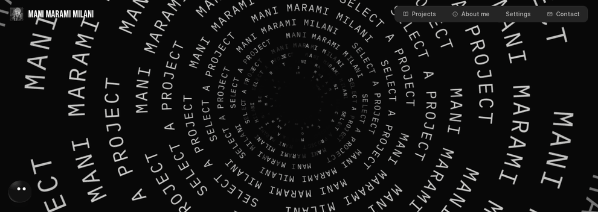

<div align="center">

> Intro snap and momentum · [live portfolio](https://manimarami.com/) · [source and verification](RELEASE.md)

<a href="https://manimarami.com/">
  
</a>

# Mani Marami Milani · Portfolio

**Eleven real projects. Direct links to the work.**<br>
An interactive portfolio with a living typographic opening, a scrolling project reel and direct project links.

[](https://react.dev/)
[](https://www.typescriptlang.org/)
[](https://threejs.org/)
[](https://vite.dev/)

[**Open the portfolio ↗**](https://manimarami.com/) · [Showcase](#the-experience) · [Controls](#controls) · [Run locally](#run-locally) · [Architecture](#architecture) · [Credits](#credits)

<br>


*Real project imagery and original interactive typography.*

</div>

## The experience

The opening is an infinite field of type. Rings fill the field around a small calm centre. Scroll to build bounded zoom momentum; opposite scrolling brakes before reversing. Hold to stop the spin and build a rubber-stretch sound and pressure tremble, then release for a short snap, letter rebound and direction reversal, then enter a reel of eleven actual projects, including Visual Music, Hermes Workspace and Paseo Kona. Pelagic opens its [GitHub repository](https://github.com/Denoax/pelagic-jellyfish-webgl) using the same direct resource-link flow as the other projects.

| Opening | Project reel |
|:---:|:---:|
|  |  |
| Infinite type, pointer ripples and held zoom | Counter-traveling native text and media, intentional previews and exact project position |


This historical v24 motion preview is a silent, resized copy of a real browser recording at its original pace. It does not replace the interactive site.

### Original Pelagic

<a href="https://github.com/Denoax/pelagic-jellyfish-webgl">
  
</a>

The original Pelagic project and its real rock-lit jellyfish previews remain intact. Explore opens the [Pelagic repository](https://github.com/Denoax/pelagic-jellyfish-webgl), where the live experience is linked; browser Back returns to the reel. The former galaxy-to-ocean bridge is retired, with recoverable source [indexed here](archive/retired-journey-20261016/README.md).

### Light and dark

| Light | Dark |
|:---:|:---:|
|  |  |

The theme buddy changes the appearance. Brightness, sound volume and Less motion control actual rendering and playback behavior. Elastic sliders keep their numeric values bounded while allowing the thumb to travel beyond the pane. The compact shared-glass Reset restores those three visible preferences without changing the selected theme.

<details>
<summary><strong>Portrait gallery</strong></summary>

<br>

<p align="center">
  
  
  
</p>

Mobile has its own composition, safe edge spacing, scrollable pane bodies and persistent Close controls. Keyboard access, reduced motion and a static graphics fallback preserve access to the real content.

</details>

## Built in

| Area | Behavior |
|:---|:---|
| Opening | Continuous sharp Ringwriter, slowly arriving outer rings, pressure hold and reversible zoom |
| Projects | Eleven real entries, manual scrolling, hover media and direct selection |
| Position rail | Displayed-position bulge on 21 fine ticks, stronger pointer hover and 11 settled markers |
| Panes | Real-content4px flying panes, native controls, immediate dismissal and shared Close |
| Preferences | Light/dark, bounded brightness, sound volume, Less motion and a scoped Reset |
| Pelagic | Original procedural jellyfish previews and direct repository link |
| Resilience | Readiness-gated route fades, cancellation, graphics retry and static content |

## Controls

| Where | Input | Result |
|:---|:---|:---|
| Opening | Scroll; plus/minus; zero | Zoom through the rings; reset the zoom |
| Opening | Deliberate hold; release | Brake spin/zoom, sustain a small letter tremble, then shuffle and reverse |
| Opening | Short click/tap; Enter or Space | Enter the project reel without a mandatory loader |
| Navigation | Projects | Enter the project reel |
| Project reel | Scroll or select a rail marker | Browse or select a real project |
| Project preview | Hover with a pointer | Play its actual media |
| Project | Explore | Open the selected project's destination |
| About / Projects / Settings | Close or Escape | Dismiss the pane and restore appropriate focus |
| Settings | Drag a slider; arrow keys when focused | Adjust the actual preference |
| Theme buddy | Activate | Change light/dark appearance |
| About | Return to the start | Replay the opening explicitly |

## Run locally

Requires Node.js 24 and npm. Dependencies are locked in `package-lock.json`.

```sh
npm ci
npm run dev -- --port 4174 --strictPort
```

Open **http://127.0.0.1:4174/**. For a production build, use a free preview port:

```sh
npm run build
npm run preview -- --port 4175 --strictPort
```

WebGL support depends on the browser and GPU. With graphics unavailable, the designed fallback retains project content and links.

## Architecture

| Layer | Source | Responsibility |
|:---|:---|:---|
| Application | [`src/app`](src/app) | Intro, reel, navigation, panes and explicit user actions |
| State and motion | [`src/core`](src/core), [`src/hooks`](src/hooks) | Routing, preferences, input ownership, rail stability and slider flight |
| Rendering | [`src/experience`](src/experience) | Three.js / React Three Fiber typography, previews and glass |
| Audio | [`src/audio`](src/audio) | User-activated playback and bounded interaction voices |
| Content | [`src/content`](src/content), [`public/assets`](public/assets) | Actual project records, captured media and source notices |
| Delivery | [`Dockerfile`](Dockerfile), [`Caddyfile`](Caddyfile) | Locked Vite build, SPA routing and static asset caching |

React 19 · TypeScript 5.9 · Three.js 0.180 · React Three Fiber 9 · Motion 14 · Vite 7. Vercel serves the verified static build at manimarami.com; GitHub pushes do not automatically deploy it. Docker/Caddy remains a historical local recovery path. See [deployment and rollback](DEPLOYMENT.md).

## Validation

The 2026-10-16 release publishes the source at `2f9293f`: bounded accumulated scroll momentum, multi-input braking before reversal, real rubber-stretch hold audio, a short release snap and damped glyph rebound. It also carries the current eleven-project catalogue, original interactive Portfolio panel, current intro banner and direct Pelagic repository navigation. Preferences, reduced motion and graphics fallback remain intact.

The source-bound local checks cover seventeen transport contracts, seven production geometry cases and native Chromium desktop/portrait scroll, hold/release, snap and cancellation behavior. Actual browser audio checks verify one audio context, five successive snaps despite travelling-wave saturation, mute and blur cancellation. The production build and public rollout are verified separately in the [release receipt](showcase/releases/intro-snap-momentum/deployment.json). Original recordings and full handoff evidence remain local. Independent Brave/Safari, physical devices, assistive technology, calibrated displays, listening and continuous human motion approval remain unverified; no new performance claim is made.

```sh
npm run typecheck
node scripts/intro-section-checks.mjs
node scripts/v28-transport-checks.mjs
```

Review history and original recordings are retained locally. [Release provenance](RELEASE.md) identifies the reviewed source and archive; [current rollout checks](showcase/releases/intro-snap-momentum/README.md) record the live result. Tests establish behavior within their scope; they do not grant subjective visual approval or physical-device coverage.

## Credits

- Portfolio, typography and choreography: **Mani Marami Milani**.
- Original [Pelagic](https://github.com/Denoax/pelagic-jellyfish-webgl), with the Aurelia foundation by Holtsetio; [MIT notice](public/licenses/Aurelia-MIT.txt).
- Menu composition studied from [Anderson Mancini](https://andersonmancini.dev/); independently implemented with Mani's real project content.
- Flying-menu interaction study: George / @vanjek via [Inspora](https://www.inspora.design/posts/flying-dropdown-menu); independently authored tile animation, softened for this portfolio.
- Intro hold and release: walthamstow_walker’s [Rubber Stetch.wav](https://freesound.org/people/walthamstow_walker/sounds/563260/), CC0; [hold processing and hashes](public/assets/audio/intro-charge/CREDITS.json), [snap processing and hashes](public/assets/audio/intro-charge/SNAP_CREDITS.json).
- Archived ripple swishes: artisticdude's [Swishes Sound Pack](https://opengameart.org/content/swishes-sound-pack), CC0; [source, edits and hashes](public/assets/audio/v22/ASSET_CREDITS.json).
- Interaction studies, navigation, fonts, NASA/ESA imagery and other media: [complete site credits](https://manimarami.com/credits), [licenses](public/licenses) and [asset notices](public/assets/notices).
- Repository presentation follows the banner/gallery/documentation structure of Mani's [Kona Desktop repository](https://github.com/Denoax/konata-hyprland-dotfiles). Its artwork is not copied. [Showcase source record](showcase/github/README.md).

Project media retain their individual licenses. Existing Kona character-art redistribution uncertainty remains documented in the site credits; this release does not establish new rights. No model-generated visual media are used.
