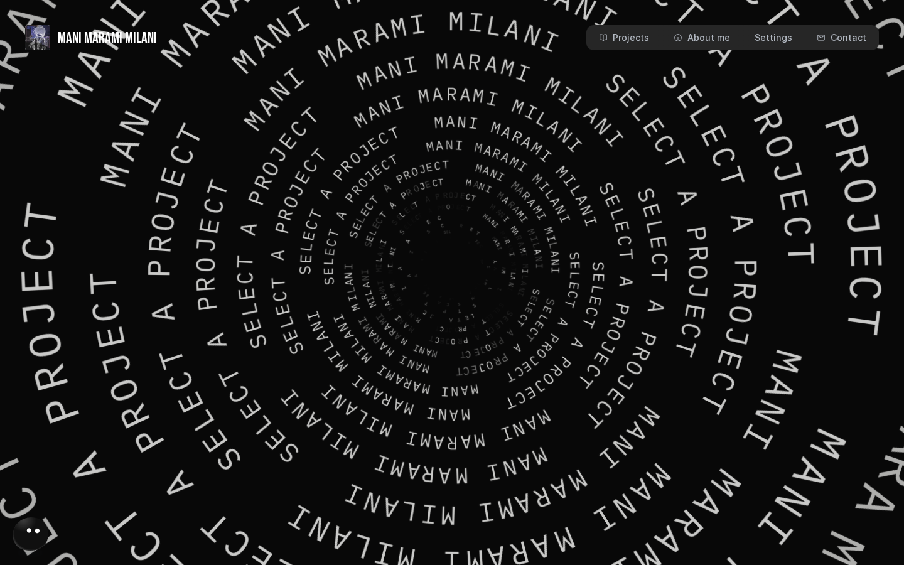
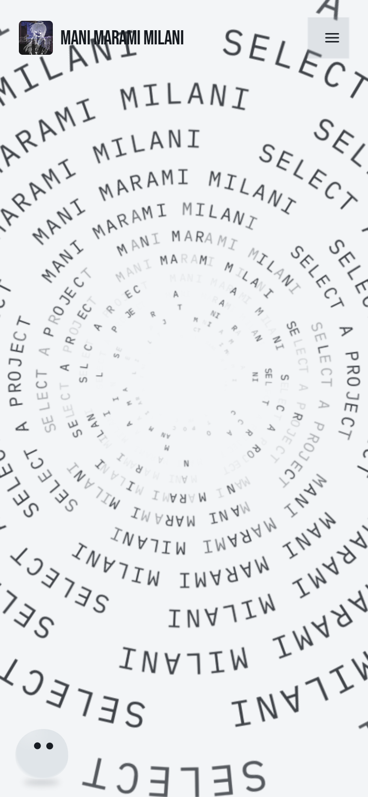

# v28.1 production verification

Published on2026-10-15 to [manimarami.com](https://manimarami.com/).
Runtime release: `18a367754cf88a58e73c970b4d2fcc35431e8a58`.
[Deployment/rollback receipt](deployment.json) · [259 reviewed output hashes](build-state.json).

| Desktop dark, held pressure | Portrait light |
|:---:|:---:|
|  |  |

These are actual public native Chromium captures. Portrait is emulation.
Hold/reverse, ten project IDs/order, reel scroll, Settings and early descent/Return
passed without page errors or failed assets. Full jellyfish arrival and physical
or additional browser checks were not traversed by this smoke. Original unedited
recordings and the earlier fixture-wait failure remain in local release evidence;
selected frames do not establish continuous human playback or visual approval.

Reproduce the read-only public smoke with Playwright/Chromium available:

```sh
V27_NATIVE_GL=1 RUNTIME_SHA=3464e2c65fd77cbdb40d580d644a0789b09d2797 node scripts/v28-live-checks.mjs
```

The original approved banner remains in the main README. No new artwork was made.
